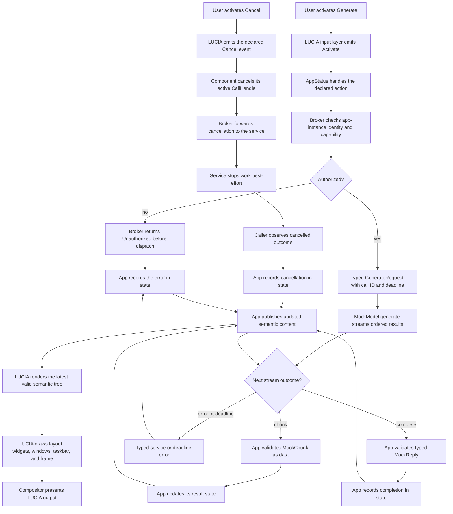

# LUCIA GUI Framework Contract

**Status: Proposed.** This document defines the first visible desktop prototype and a minimal subsequent app-content contract for evaluation, not an accepted implementation specification. LUCIA should provide native typed and described interfaces for components, actions, state, services, and observability, designed to be usable by LLMs and agents. MCP is not required in the runtime or MVP. The assistant is a prominent, first-class desktop experience: its main menu button is centered on the taskbar, pinned or open app icons appear to its right, and activating the button opens a prompt with the conversation displayed above it. Exact dimensions and visual treatment remain open. Agents request the same semantic actions through LUCIA as users, but use distinct principals and pass the same capability and policy checks. They cannot inject raw input or bypass confirmation. Agent requests are not user consent. These are product requirements and proposed directions, not implementation facts. The product direction is to build a LUCIA GUI framework for LUCIA desktop components and apps, replacing GTK as the intended product foundation. Apps provide typed descriptions of their content plus app state and actions. LUCIA provides the desktop frame and taskbar, window decorations, widget layout and drawing, view composition, and all desktop graphics handling. Apps do not render pixels or surfaces and do not process desktop graphics. The framework is distinct from a compositor/display server. The selected architecture directions below remain proposed and are not an approved implementation specification. The compositor, long-term display protocol, compiler details, renderer implementation, text shaper, packaging details, and accessibility API also remain open.

## Initial Frame Prototype: LUCIA-Owned Desktop

The initial visible prototype established a LUCIA-owned desktop frame: a restrained background and bottom taskbar rendered by LUCIA across the target output. That prototype taskbar contains only LUCIA identity and one static workspace indicator. It has no app icons or assistant controls; it is not the proposed product interaction defined below. It is not Weston's fixture panel or content submitted by an app. This bounded prototype is evidence for the initial frame only; it is not a full framework, compositor, desktop shell, or app-content implementation.

**Prototype acceptance criterion:** The LUCIA-owned background fills the compositor-configured output and its bottom taskbar bounds match that output. Weston uses its kiosk shell with no Weston panel, and no app window or app-submitted content is shown. Output dimensions are derived from compositor configure events rather than fixed to one display size. The visual treatment and implementation technology remain provisional.

## Subsequent App-Content Slice

After the desktop-frame milestone, an application using the framework can:

- Submit a typed description for one top-level window and its content, including a vertical layout, text label, and button.
- Provide app state and declare an action for the button; receive a semantic activation event and publish updated state/content.
- Expose accessible label, role, and name as content metadata.
- Express dimensions in scaling-friendly logical units rather than physical pixels.
- Report startup, runtime, and shutdown lifecycle events and receive errors.

LUCIA owns the window frame and decorations, layout, widget drawing, composition, pointer and keyboard interpretation, focus order and visible focus, and the graphics work needed to present the view. Apps own their content description, state, and action behavior. The app/framework interface carries typed content and semantic action/lifecycle/error events; it does not expose a drawing API or require apps to handle raw desktop input or graphics.

This slice establishes basic client behavior only. It does not imply a full widget set or settle how applications are structured.

## Proposed Assistant-First Taskbar Interaction

- The LUCIA main-menu button is horizontally centered on the taskbar.
- Pinned and currently open app icons appear to the right of that button. Their grouping and ordering remain open.
- Activating the LUCIA button opens the assistant prompt field. The conversation is displayed above the prompt, with prior turns available in that conversation area.
- LUCIA owns and renders the taskbar, prompt, conversation, focus, and input handling. The assistant and app components contribute typed semantic content and actions, never pixels.
- An agent initiated from the assistant may request the same declared semantic actions available to the user. It acts under a distinct agent identity and remains subject to capabilities, policy, cancellation, audit, and explicit user approval for sensitive or consequential actions.

This is the proposed interaction layout, not an implemented feature. Exact sizing, app-icon ordering and grouping, conversation history retention, and responsive behavior remain open.

## Proposed Application Architecture

The following is a concrete direction for evaluation, not an approved language, compiler, runtime, or protocol specification:

- Use one LUCIA language and compiler for both frontend and backend code. Give the language distinct declarative UI component modules and backend service modules, with explicit effect permissions for service capabilities.
- Execute app frontend modules in a per-app sandbox hosted by LUCIA and run backend services in separate OCI workloads. An app may have one or more backend services. The frontend describes semantic content, state, and behavior; LUCIA owns the renderer and session/service broker. Neither frontend nor backend workloads draw pixels, access graphics APIs, or submit surfaces.
- Compose small UI components inside the frontend artifact instead of making every label, button, or internal component a container or service. Container boundaries are for app and backend isolation, permissions, and lifecycle, not individual widgets.
- Keep app containers unprivileged and service-isolated. Do not pass compositor sockets, graphics devices, host devices, host D-Bus, or privileged broker/compositor interfaces into them. Apps use no JavaScript frontend or rendering path.

## Proposed Engine MVP Contract

**Status: Proposed, implementation-neutral.** This section defines observable engine behavior for evaluation. The Q&A selected concrete directions for evaluation, recorded below, but did not approve implementation or close the remaining decisions. The product direction remains a custom LUCIA language for UI and backend modules, support for one or more backend services per app, semantic app content and behavior, and LUCIA ownership of the renderer, background, taskbar, and first-class assistant. Apps do not submit desktop pixels or use JavaScript.

### Selected Q&A Directions (Proposed; Not Approved Implementation)

These are user-selected MVP directions. Every row remains proposed and not implemented; none establishes an approved implementation or completed behavior.

| User-selected MVP direction | Status |
| --- | --- |
| Execute frontend modules as Wasm in a per-app sandbox hosted by LUCIA; run each backend in a separate OCI workload. | Proposed; not implemented |
| Use LUCIA interface declarations to generate typed service bindings. | Proposed; not implemented |
| Mediate every app-to-backend call through the LUCIA broker. | Proposed; not implemented |
| Use Protobuf with gRPC over UDS for local RPC. | Proposed; not implemented |
| Require runtime user approval for capability access. Grant duration is unresolved; the user canceled that question. | Proposed; not implemented |
| Publish full semantic-tree snapshots. | Proposed; not implemented |
| Handle events sequentially per component while service calls remain asynchronous and cancellable. | Proposed; not implemented |
| Make backend failure visible and require manual restart; do not imply automatic recovery. | Proposed; not implemented |
| Include a LUCIA-managed shared local `ModelProvider` in the first runnable LLM slice, with a deterministic mock for tests. | Proposed; not implemented |

LLM-friendly means native LUCIA interfaces expose typed, machine-readable component, action, state, service, event, and observability contracts with descriptions and constraints. LLM output is untrusted input, not a privileged source of truth.

### Responsibilities and Component Contract

- The LUCIA engine owns the desktop frame, background and taskbar, semantic-tree validation, layout, rendering and presentation, input interpretation, focus, and delivery of declared semantic events. Only LUCIA communicates with the compositor or handles desktop graphics.
- An app publishes a versioned semantic tree, not pixels or drawing commands. The MVP tree supports stable node identity, container/layout nodes, text, buttons, logical dimensions, and accessible role/name/label metadata. The engine rejects malformed or unsupported trees as typed app errors without replacing the last valid view.
- A component owns its declared state and handles only its declared events. Events are handled sequentially per component; service calls are asynchronous and cancellable so the component and session can respond to stop requests. For each event, it computes a state transition and publishes a full semantic-tree snapshot; the engine presents that snapshot. Engine-generated activation includes the target node and event identity.
- Components have observable `created`, `active`, and `stopped` lifecycle states. Events are delivered only while active; shutdown stops new events, then reports completion or failure. Lifecycle notifications are engine-owned and cannot be forged by app content.

### Service Broker and Call Contract

- An app may declare one or more backend services with typed operations. Every app-to-backend call goes through the broker, which routes only between that app instance and its declared services and enforces caller and service identity plus the capabilities granted for each operation. Undeclared capabilities and calls without an applicable grant are denied before dispatch by default. Runtime user approval is required for capability access; grant duration remains unresolved. Apps and services receive no implicit host, graphics, device, or arbitrary-network access.
- Every operation has a typed request and either a typed reply or a typed stream. A request has a correlation identity and deadline; expiry stops waiting and requests cancellation of work. Explicit cancellation is propagated to the service and terminates the caller's wait. Cancellation is best-effort once work has begun, so callers must not assume a side effect was rolled back.
- A stream delivers ordered typed items, then exactly one terminal success or error. Cancellation closes delivery; implementations bound buffering and apply backpressure rather than silently dropping items. Calls report distinguishable validation, authorization, unavailable-service, deadline, cancellation, and service-failure outcomes. No implicit retry may duplicate a non-idempotent operation.
- Identity and capability checks apply to every call, including calls within the same app. The broker exposes no ambient service discovery or cross-app access. Agent requests use distinct principals and the same LUCIA semantic action surface, capability checks, and policy checks as user requests; they cannot inject raw input or bypass confirmation. Grant duration, identity representation, and enforcement mechanism remain open.

### Process, Model, and Failure Contract

- The engine starts only declared app/backend workloads and assigns each running app instance an identity boundary. Workloads are unprivileged and isolated from compositor/graphics interfaces and host resources. Backend readiness is observable before calls are accepted.
- Normal shutdown stops new work, signals active components/services to stop, and enforces a bounded grace period before reporting forced termination. Startup failure, crash, timeout, and forced termination are visible to the app/session; pending calls fail with a typed outcome. Backend failure is visible and recovery is by manual restart. Persistent-data behavior remains open.
- The first runnable LLM slice includes a LUCIA-managed shared local `ModelProvider` service behind the broker and typed interface; deterministic mock implementations remain available for tests. Provider credentials stay in the managed service boundary. This does not select remote-provider access or policy.
- Model and agent output is untrusted data. It cannot mutate the semantic tree, change capabilities, or invoke actions directly. An agent may request a declared semantic action through LUCIA, subject to its distinct principal and the same capability and policy checks as a user. Proposed guardrails: deny undeclared capabilities by default; require user approval for sensitive or consequential actions; provide a stop/cancel control; and audit actor, action, and result. An agent action is not user consent, and confirmation cannot be supplied by the agent itself.

### Observability, Testing, and MVP Acceptance

- The engine exposes native LUCIA typed, machine-readable component, action, state, service, event, and observability schemas with descriptions and constraints, plus structured lifecycle, call, stream, cancellation, deadline, authorization, and failure events. Audit records identify actor, action, and result. Diagnostics must not expose credentials; prompt/response payload capture is off by default.
- Contract tests cover valid and invalid trees, state/event transitions, focus and semantic activation, capability denial, one-way isolation between app identities, request/reply and stream termination, deadlines, cancellation, service failure, and shutdown. Agent tests cover distinct principals, declared-action enforcement, denial, approval gating, audit, and stop control. Mock-model tests assert deterministic output and validation of untrusted data.
- The initial runnable LLM slice reuses the current LUCIA-owned taskbar and app-component scenario as semantic content, with the managed local `ModelProvider`; tests also use a deterministic mock. The first-class assistant can propose a semantic action, which follows the agent flow below. The existing direct-rendering prototype is test evidence only and does not satisfy this engine contract.
- MVP acceptance requires the slice to run with LUCIA drawing both taskbar and app content; no app receives pixels, graphics access, or JavaScript execution. It must demonstrate typed-tree rejection while retaining the last valid view, event-driven state updates, broker identity/capability enforcement, ordered streaming, deadline and cancellation propagation, typed failure and shutdown reporting, mock-provider determinism, and explicit user approval for sensitive actions. The checks must be repeatable without a physical display.

### Concrete MVP Flow, Contract, and Ownership

**Status: Proposed.** This is an end-to-end example of the preceding contract, not evidence that these interfaces or runtime behavior are implemented. Here, “known constraint” means a constraint recorded in this proposal, not implementation evidence or formal acceptance. The app supplies semantic content and state only. LUCIA interprets input, checks and routes service calls, and turns the latest valid semantic tree into graphics; apps and services never render pixels.



The contract uses the document's illustrative pseudo-syntax; it is not a grammar, wire format, or compiler commitment. `CallHandle`, `NodeId`, `EventId`, and `Deadline` are typed opaque values at this boundary. In particular, the app does not receive or construct broker identity tokens. Correlation and deadline belong to the brokered call context, not to the app's `GenerateRequest` payload.

| Contract element | Proposed shape and responsibility |
| --- | --- |
| Component | `component AppStatus(props: { prompt: Text })`; owns its app content, action behavior, and state. It publishes semantic nodes, never drawing commands or pixels. |
| State | `state status: Text = "Ready"`; `state result: Text = ""`; `state active: CallHandle? = none`. The component changes state in response to declared events and publishes the resulting semantic tree. |
| Events | `Activate(target: NodeId, eventId: EventId)` is emitted by LUCIA for an active component's declared action. `Cancel(call: CallHandle)` is the component's declared cancellation action; raw pointer/keyboard events stay with LUCIA. |
| Request and reply | `GenerateRequest { prompt: Text }`; terminal success is `MockReply { status: Text }`. The service call carries broker-managed correlation and deadline metadata separately from these payloads. |
| Service operation and stream | `service MockModel provides { mock_model.generate }`; `operation generate(request: GenerateRequest) -> stream item MockChunk, terminal MockReply | ServiceError`. `generate` itself is the streaming operation; invocation yields an opaque `CallHandle` for cancellation, and ordered `MockChunk { text: Text }` items are followed by one reply or error. |
| Errors and cancellation | `ServiceError = InvalidRequest | Unauthorized | Unavailable | DeadlineExceeded | Failed`. Broker denial returns `Unauthorized` without dispatch. `cancel(active)` is call control, not a second model operation; the broker propagates it and the caller observes `cancelled`. Stopping work is best-effort, not rollback. |
| Capability and identity | The app declares `requires { mock_model.generate }`. Undeclared capabilities are denied by default; the broker checks app-instance identity and runtime user-approved grants on every call. Agent principals are distinct and undergo the same LUCIA capability and policy checks as users. Grant duration is unresolved; no token internals are assumed. |
| Agent action and consent | An agent requests the same declared semantic action through LUCIA as a user and passes the same checks. It cannot inject raw input or provide its own user consent. |

| Area | Status | Ownership or current boundary |
| --- | --- | --- |
| App behavior and content | Known constraint | The app owns semantic content, state, and declared action behavior. It never renders pixels; there is no JavaScript app-rendering path. |
| Desktop and graphics | Known constraint | LUCIA owns the background, taskbar, window decorations, layout, widget drawing, composition, and graphics presented to the compositor. |
| Language and modules | Proposed direction | A custom LUCIA language for frontend and backend code is desired. Syntax, type/effect system, compiler, and runtime are not selected. |
| Workload packaging | Proposed direction | Frontend modules run as Wasm in a per-app sandbox hosted by LUCIA; each backend is a separate OCI workload. Widgets are not containers. Exact execution and lifecycle design remain open. |
| Service broker | Proposed contract | Typed operations, per-call identity and capability checks, deadlines, cancellation, and ordered streams. Every backend call is brokered; undeclared capabilities are denied by default and capability access requires runtime user approval. Broker placement, identity issuance, grant duration, and enforcement details remain open. |
| Renderer, toolkit, and transport | Partly selected direction; still proposed | Compiler/runtime and renderer/toolkit remain open. The user-selected local RPC direction is Protobuf with gRPC over UDS; it is not approved or implemented. |
| Model and sensitive actions | Proposed constraints; provider policy open | Include a LUCIA-managed shared local `ModelProvider` in the first runnable slice and use a deterministic mock for tests. Treat output as untrusted; sensitive or consequential actions require explicit user approval. Later remote-provider, privacy, and network policy remain open. |
| MVP vertical slice | Proposed | A LUCIA-owned taskbar and renderer present an app's status text and action button. The action requests a stream from the shared local `ModelProvider` through the broker, validates chunks, updates app state, and republishes semantic content; cancellation and typed errors are visible. A separate sensitive action remains blocked until explicit confirmation. |

### Explicit Non-Goals

The MVP does not build a compositor/display server, define a complete widget library or accessibility API, support arbitrary app networking, permit apps to render pixels, select a production remote model provider, or settle app-to-app communication. Remaining open decisions are listed once in the final Open Decisions section.

### Proposed Backend Communication

The user-selected proposed direction for local app-to-backend calls is LUCIA interface declarations mapped to versioned Protobuf schemas, generated bindings, and gRPC over Unix-domain sockets (UDS). The LUCIA-owned broker exposes only declared service endpoints after runtime user approval for capability access; this proposal does not include arbitrary app networking or service discovery. These choices remain unapproved and unimplemented.

Keep request/response calls, one-way events, and server streams as distinct interface forms. Calls should carry deadlines and cancellation and return typed status/errors. Server streaming can carry LLM tokens and other ordered events, with defined cancellation and backpressure behavior. Version schemas deliberately and generate frontend/backend bindings from LUCIA interface declarations rather than maintaining parallel handwritten contracts.

This favors typed contracts and local process isolation, but adds compiler/binding work and RPC operational complexity. UDS confines this proposal to local services; remote-provider access, if permitted, belongs behind an explicitly authorized LUCIA-owned service rather than direct app connectivity. The exact schema evolution, authentication/capability enforcement, and stream flow-control rules remain to be evaluated.

### Early LLM Integration

Treat LLM support as an early framework integration. The first runnable slice includes a LUCIA-managed shared local `ModelProvider` backend service with streamed responses through the typed service interface; tests also use a deterministic mock. Provider credentials stay with the provider service and are never placed in app containers. Remote-provider support is not part of this first-slice direction.

Model output is untrusted data or a proposal: it cannot directly mutate LUCIA's UI tree, grant capabilities, or invoke privileged actions. The app validates outputs against its own typed state and behavior; sensitive or consequential actions require explicit user confirmation. Provider access, privacy policy, and any remote connectivity remain open decisions.

### Proposed MVP Stages

1. Review the language/module split, effect permissions, typed interface shape, and isolation model. Keep the compiler, runtime, and protocol choices provisional until this review is explicit.
2. Specify the semantic component tree and broker boundary, then evaluate a Wasm frontend component hosted by LUCIA and a separate OCI backend with the shared local `ModelProvider`. Preserve LUCIA ownership of all rendering and desktop graphics.
3. Use a LUCIA taskbar component and a minimal app component with typed state/action behavior as the first end-to-end example; connect the app to its backend over the proposed local interface direction.
4. Verify the shared local `ModelProvider` flow with deterministic mock tests, checking schema validation, cancellation/error handling, credential isolation, capability approval, and confirmation before sensitive actions. Broader provider implementations and component/service coverage remain later work.

These stages describe a proposed evaluation path; they do not authorize or specify compiler/runtime implementation in this document.

## Illustrative API

## Illustrative Proposed Syntax (Pseudo-Syntax)

This sketch expresses the proposed MVP contract; it does not claim implemented behavior. Keywords and grammar are not locked. The taskbar remains LUCIA-owned (identity and workspace indicator); `AppStatus` is separate app content. LUCIA draws the taskbar and all graphics, while the app publishes only its semantic content. The broker mediates the declared mock capability. Model output is validated as data, and applying it requires explicit user approval.

```text
component AppStatus(props: { prompt: Text }) {
	state status: Text = "Ready"
	state result: Text = ""
	requires { mock_model.generate }

	content Column {
		Label(status)
		Label(result)
		Button("Generate", action: Generate)
		Button("Cancel", action: Cancel)
		Button("Apply", action: Apply)
	}

	action Generate {
		status = "Generating"
		active = mock_model.generate(GenerateRequest(prompt: props.prompt))
		for active {
			item(chunk: MockChunk) {
				result = validate_append(result, chunk.text)
				publish()
			}
			complete(reply: MockReply) { status = reply.status; publish() }
			cancelled { status = "Cancelled"; publish() }
			error(failure: ServiceError) { status = "Failed"; publish() }
		}
	}
	action Cancel { cancel(active) }
	action Apply {
		require explicit_user_approval("Apply generated result")
		apply_validated(result)
	}
}

service MockModel provides { mock_model.generate } {
	operation generate(request: GenerateRequest)
		-> stream item MockChunk, terminal MockReply | ServiceError
}

record GenerateRequest { prompt: Text }
record MockChunk { text: Text }
record MockReply { status: Text }
```

The engine presents the semantic content and delivers declared actions; neither the app nor service renders pixels. The stream has ordered chunks and one terminal reply or error; cancellation stops further delivery and reaches the caller as `cancelled`. The mock service is deterministic and needs no live provider. This example leaves concrete syntax, types beyond the illustrative boundary, and runtime behavior for later review.

## Client and Container Boundary

Each app frontend runs as a Wasm module in a per-app sandbox hosted by LUCIA; each backend service runs in a separate unprivileged OCI workload. They communicate through typed interfaces mediated by LUCIA. The LUCIA rendering service, not the app, communicates with the compositor and handles graphics needed to present app content. Backend workloads must not receive a compositor surface/socket, seatd access, DRM or other host devices, host D-Bus, or a rootful `containerd` socket. Apps provide semantic content through the framework; there is no JavaScript frontend or app-owned rendering path. The user-selected Protobuf/gRPC-over-UDS direction remains proposed, not approved implementation or a decision about desktop-session topology or the final compositor/protocol.

## Evaluation

1. First, verify the desktop-frame acceptance criterion on the target display: the LUCIA fullscreen surface fills the configured output, the bottom taskbar is within that frame, Weston uses its kiosk shell with no desktop panel, and no app window or content is shown.
2. After that milestone, run an app in an unprivileged OCI container with a LUCIA rendering service and a separate headless compositor; only the LUCIA service receives the private compositor client socket. Verify typed content presentation, LUCIA-managed pointer and keyboard activation and focus, semantic action delivery, app state/content updates, scaling-friendly logical dimensions, lifecycle reporting, and errors. This is a test arrangement, not a long-term Wayland protocol or compositor selection.
3. The physical Weston kiosk-shell fixture is used only to present the background prototype on hardware; its desktop shell and panel are not visible. Existing Weston/GTK launcher evidence remains limited to that experimental integration fixture and does not establish framework behavior or select Weston.
4. Decide the final compositor and display protocol separately, based on reviewed evidence and an explicit decision.

## Prototype Evidence (2026-11-02)

The physical presentation in this prototype is the LUCIA-owned fullscreen
background and bottom taskbar from
[`desktop-container/gui-prototype`](../../desktop-container/gui-prototype/README.md)
using a separate C/Wayland/Cairo renderer that requests a fullscreen surface,
uses compositor-configured dimensions, and draws a taskbar with only LUCIA
identity and one workspace indicator. The physical runner checks the downloaded
Weston runtime's advertised shell option and kiosk-shell module, then requires a
fullscreen configure, matching bottom-taskbar bounds, and presented-frame
marker. Weston runs with that kiosk shell, not its desktop panel. This
demonstrates only the LUCIA-owned desktop frame on one output; it does not
demonstrate a framework, app composition, or production desktop session.

Separately, the provisional C/Wayland/Cairo window client in
[`desktop-container/gui-prototype`](../../desktop-container/gui-prototype/README.md)
is used only by the headless window regression. The background/taskbar client is
also built and run by the headless check at a 1024 by 768 output size, with
fullscreen, bottom-taskbar, static-shell-element, and presented-frame markers.
It builds from Ubuntu archive
packages and runs against the Weston headless fixture; it is not shown on the
physical display and does not launch an app. The separate window client draws its
own content and communicates with Wayland directly, so it does not implement
the app/LUCIA responsibility or container boundary clarified in this proposal.
Its smoke check covers a configured and presented 480 by 320
logical-unit window, vertically arranged text and button, visible focus,
keyboard and pointer activation handler paths, status updates, client-side
accessible metadata, lifecycle markers, and the private client/compositor
container boundary. Weston headless advertises no input seat, so the activation
check calls the same event handlers in-process; this is not compositor-injected
or physical input validation. Core Wayland does not expose the prototype's
accessible metadata to assistive technology. See the prototype matrix for all
coverage and gaps. This is evaluation evidence only, not a client-rendered or
hybrid architecture recommendation: GTK remains an experimental fixture, and
no app/framework language or protocol, renderer implementation, compositor, or
display protocol is selected.

## Non-Goals

- Building a custom compositor or display server.
- Building a graphics driver or low-level input/seat broker.
- Launching actual applications as part of the taskbar milestone.
- Treating the GTK launcher fixture as the GUI framework implementation. It remains an experimental integration fixture.

## Open Decisions

The following remain open: LUCIA language syntax and type/effect system; compiler/runtime architecture; exact UI module model; schema evolution; broker placement and identity issuance; capability enforcement details and grant duration (see the user-selected MVP decisions table); service lifecycle rules; renderer implementation and text shaping; packaging details beyond the selected Wasm/OCI direction; complete scope and accessibility API; GTK compatibility; compositor and long-term display protocol; and ModelProvider privacy and any later remote-provider policy. The user-selected MVP directions remain proposed and not implemented, not approved decisions. Do not infer a grant duration or treat a proposal as final without explicit review.